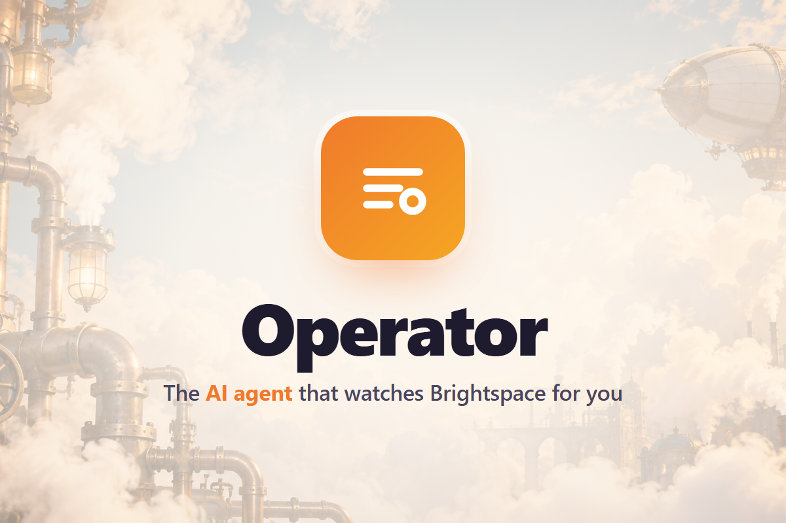
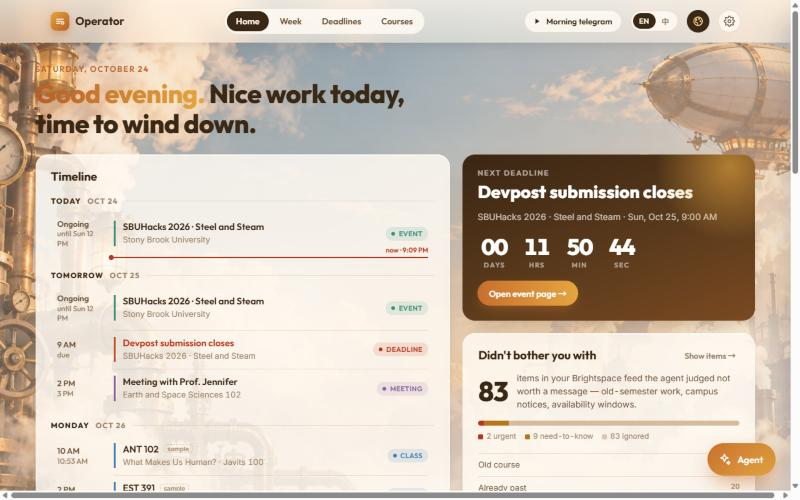

# Operator 🚂📠

English · [中文](README.zh-CN.md)

**The telegraph operator who watches your Brightspace, so you never log in again.**

Operator is an agent for Stony Brook students. It reads your Brightspace calendar feed every ten minutes, decides what actually matters, and sends you a short telegram over iMessage only when it does. You can text it back, send it a voice note or a photo of a timetable, or just talk to it on the dashboard. It answers, records what you tell it, and remembers what you have already finished.

Built in 36 hours for **SBUHacks 2026 · Steel and Steam** ([Devpost](https://devpost.com/software/operator-y1zcet)).

> **Status:** the hackathon deployment at myoperator.club was taken down after the event. Everything runs locally with `npm run web`; see *Run it yourself* below.

[](https://youtu.be/1TopOzZE1o8)

▶ **[Watch the 5-minute demo](https://youtu.be/1TopOzZE1o8)** · [Devpost submission](https://devpost.com/software/operator-y1zcet)



## What it does

| | |
|---|---|
| **Watches Brightspace** | Pulls the iCal feed every 10 minutes, diffs it against the last snapshot, and notices when a professor quietly moves a deadline. |
| **Triages instead of forwarding** | Every item is judged *urgent / need-to-know / ignore*. In one real feed, 83 of 94 items were ignored (old semesters, past dates, availability notices). Ignored items are never pushed. |
| **Sends telegrams** | `EST 393 · HW#3 moved: Thu, Oct 29, 11:59 PM → Mon, Oct 26, 11:59 PM.` over iMessage, plus 24 h / 3 h / 1 h reminders. |
| **Takes replies** | Text, voice notes and photos from your phone go through one Gemini call that decides the intent: *done*, *undo*, *question*, *add*, *clarify*, *chat*. It only acts when it is sure; otherwise it asks. |
| **Reads aloud** | A spoken briefing (Gemini writes it, ElevenLabs reads it) as a voice note on your phone or on the dashboard with live word-by-word subtitles. |
| **Voice call** | Hands-free mode in the dashboard: pause for a second, it sends; it answers out loud; it listens again. |
| **Dashboard** | Home, week view, every deadline, per-course cards, bilingual (EN / 中), three skins. One input, one navigation, no filters to configure. |

## How it works

```
Brightspace iCal ──► poll.ts (diff) ──► triage.ts ──► store ──► server.ts ──► web/index.html
                                            │                      ▲
                                            ▼                      │
                                       photon.ts  ◄── brain.ts ◄───┘ (text · voice · photo)
                                      (iMessage)        │
                                                        ▼
                                                  gemini.ts  ·  voice.ts (ElevenLabs)
```

- **`src/poll.ts`** fetches and parses the feed, compares it with `data/snapshot.json`, logs changes and sends change telegrams.
- **`src/triage.ts`** is rule-based and explainable: exams are always urgent, anything due within 72 h is urgent, quizzes within a week are urgent, past items and other semesters are ignored.
- **`src/brain.ts`** is the phone-side brain. One Gemini call per message with the live schedule in context; it returns an intent and the reply in the user's language. Voice notes are transcoded with ffmpeg first, and the prompt forbids acting on audio it cannot hear.
- **`src/agent.ts`** runs the loop: inbound listener, polling, reminders, and pre-generating the spoken briefing so a click plays instantly.
- **`web/index.html`** is a single file: no framework, no build step.

## Run it yourself

Requirements: Node 22+, ffmpeg (for voice notes).

```bash
git clone https://github.com/Owl-Lee/operator.git
cd operator
npm install
cp .env.example .env     # fill in the keys you have — everything degrades gracefully
npm run web              # dashboard on http://localhost:4242
```

| Key | Needed for | Where to get it |
|---|---|---|
| `BRIGHTSPACE_ICAL_URL` | everything | Brightspace → Calendar → Subscribe. Or paste it in the dashboard's Setup page. |
| `GEMINI_API_KEY` | understanding text, photos, voice; Q&A | [aistudio.google.com/apikey](https://aistudio.google.com/apikey) |
| `IMESSAGE_PROJECT_ID` / `IMESSAGE_PROJECT_SECRET` / `MY_PHONE` | telegrams and replies over iMessage | [Photon](https://app.photon.codes) Spectrum project. On the shared line, text it once first. |
| `ELEVENLABS_API_KEY` | spoken briefing, read-aloud, voice call | [elevenlabs.io](https://elevenlabs.io) |

Without Gemini, the agent still polls, triages and sends telegrams; the dashboard falls back to a rule-based parser. Without Photon, telegrams are drafted in the log instead of sent. Without ElevenLabs, voice features are hidden.

Other scripts: `npm run poll` (one poll), `npm run ping` (test telegram), `npm run typecheck`.

The server process must run in the schedule's timezone (`TZ=America/New_York`), since times in `schedule.json` carry no zone.

## Project layout

```
src/
  server.ts    HTTP API + static dashboard, starts the agent
  agent.ts     poll loop · reminders · inbound · briefing warm-up
  poll.ts      iCal fetch, diff, change telegrams
  triage.ts    urgent / need-to-know / ignore rules
  brain.ts     phone-side intent brain (one Gemini call per message)
  gemini.ts    Gemini REST client with model fallback
  photon.ts    iMessage send/receive, ffmpeg transcoding
  voice.ts     ElevenLabs TTS with timestamps, cached briefing
  schedule.ts  classes / meetings / events / deadlines on disk
  store.ts     snapshot, agent log, done list
web/
  index.html   the whole dashboard
schedule.json  your classes, meetings and events (items marked sample are placeholders)
data/          runtime state (gitignored)
```

## Sponsor tech used

Google Gemini · Photon (iMessage) · ElevenLabs · GoDaddy Registry (domain) · Vultr (hosting)

## Team

Built by [Owl-Lee](https://github.com/Owl-Lee) at Stony Brook University, October 2026.

## License

MIT
